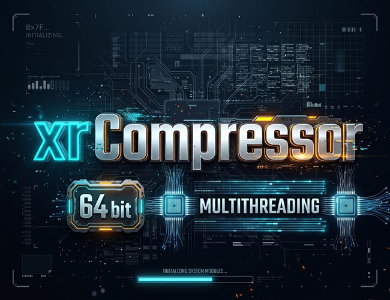

<div align="center">

# xrCompressorMT



</div>

**Багатопотоковий x64 пакувальник / розпакувальник / перевіряльник архівів `.db` / `.xdb` для S.T.A.L.K.E.R.**

Один `.exe`: подвійний клік — вікно (UA / EN), запуск з аргументами — консольний пакувальник.

**Українська** | [English](README.md)

## Можливості

- **x64 і багатопотоковість** — стиснення LZO на всіх ядрах (`-threads N` для обмеження)
- **Один файл** — без аргументів відкривається GUI, з аргументами працює як консольна утиліта
- **Пакування, розпакування, перевірка** — після запису перевіряється CRC32 кожного файлу (вимкнути: `-noverify`)
- **Автоподіл** — архів ділиться за `-max_size` МБ (за замовчуванням 1900, максимум 2047) на `name.xdb0`, `name.xdb1`, … (до 36 частин)
- **Дедуплікація** — однакові файли в межах архіву зберігаються один раз
- **Файли без стиснення** — те, що рушій читає потоково, не стискається: `*.geom`, `*.geomx`, `*.ogm`, `*.ogg`, `level.ai`, `game.graph` (інакше OGSR / OpenXRay падають); список розширюється через `datapack.ltx`
- **`datapack.ltx`** — `[header]`, `[include_folders]`, `[exclude_folders]`, `[include_files]`, `[exclude_files]`, `[options]`, `[store_files]`
- **Юнікодні шляхи** (кирилиця) у GUI та консолі
- Режими: `lzo1x_999` (макс. стиснення, за замовчуванням), `-fast`, `-store`

## Сумісність

COC, COP, Monolith (xray-monolith), OpenXRay, OGSR (`.xdb` у папці мода), SOC.

> **SoC (оригінальний exe):** кладіть `.xdb` у папку модів (`$mod_dir$`) — з кореня гри SoC читає лише `.db`.

## Використання

**GUI:** запустіть `xrCompressorMT.exe` без аргументів. Покладіть `datapack.ltx` поруч з exe — заголовок архіву береться з нього автоматично. У вкладці розпакування кнопка «Додати всі з папки» шукає архіви (`.xdb*` / `.db*`) і в підпапках.

**Консоль:**
```
xrCompressorMT <папка> [-ltx datapack.ltx] [-xdb] [-max_size МБ] [-fast | -store] -out <ім'я.xdb>
xrCompressorMT -check  <архів> [архів ...]
xrCompressorMT -unpack <архів> <папка_виводу>
```
У `cmd`: `start /wait xrCompressorMT.exe ...`

Приклад:
```
xrCompressorMT.exe "D:\mod\gamedata" -ltx datapack.ltx -xdb -max_size 1900 -out mymod
```

Повний опис опцій, формат `datapack.ltx` і формат архіву — в [README.md](README.md).

## Збірка

```sh
pip install ziglang
sh build_win64.sh      # Windows x64: xrCompressorMT.exe
sh build_linux.sh      # Linux: лише консоль
```

## Ліцензія

**GPL-2.0** — проєкт містить бібліотеку LZO (Markus F.X.J. Oberhumer, GPLv2).

## Автор

Ivan Danko, 2026 · Telegram: [t.me/frozen_zone](https://t.me/frozen_zone)
